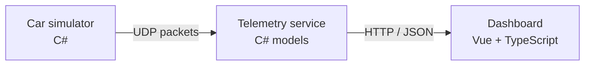

# F1 Car Simulator

A virtual Formula One car written in C# that streams live telemetry over UDP, with a Vue + TypeScript dashboard that shows the car's state, progress and traces.

## Overview

I built this to understand how race teams stream car data and turn it into something an engineer can read at a glance. The simulator models a car lapping a circuit and sends its state as UDP packets every 100ms; a C# service decodes them into typed models and serves them to a live web dashboard.

## Features

- **Car simulation** – speed, gear, RPM, throttle, brake and steering around a lap of Silverstone
- **Vehicle state** – tyre temperatures per corner, engine temperature and fuel load
- **Race state** – lap count, distance, current and best lap times, race progress and flag status
- **UDP telemetry stream** – binary packets every 100ms, decoded into typed C# models
- **HTTP endpoints** – GET /api/telemetry and GET /api/parameters for the frontend
- **Live dashboard** – gauges, bar meters and rolling speed, steering and flag traces

## Architecture



## How the car model works

- **Virtual track, sectors and segments:** An array of ```TrackSegment``` classes is initialised to represent the track. Each segment informs the car of the target inputs: steering angle, throttle and brake.
- **Car Inputs:** Every tick, the car evaluates its position on the track to find its target inputs. These 3 inputs then determine every other data point of the car.
- **Speed and gears:** Acceleration is calculated through engine force, brake force and drag. This acceleration determines the speed delta per tick. This speed determines the distance delta per tick. Gears and RPM are calculated artificially via clamping and arithmetic. This allows every lap to be authentically different as it is determined by every previous tick. This is preferred over a set, predicatable system.
- **Fuel:** The remaining fuel is calculated using the RPM, speed and the throttle input.
- **Temperatures:** Tyre and engine temperatures are calculated every tick based off various factors, such as combustion heat, air cooling, radiant cooling and tyre friction.
- **Flags:** Race flags can be switched (e.g. to a yellow flag) every tick based off set, very small probabilities. 

Known simplifications:
- The track uses estimated numbers and proportions
- There is no tyre degradation yet
- Diminishing fuel weight is not considered yet

## Tech stack

- **Simulator & service:** C#, .NET 9.0, UDP sockets, ASP.NET
- **Dashboard:** Vue 3, TypeScript, Tailwind CSS, Vite

## Getting started

### Prerequisites
- .NET SDK
- Node.js 20.19+ or 22.12+

### Run it
```bash
# 1. Start the telemetry service
cd src/RaceSim.Generator
dotnet run

# 2. Start the simulator
cd ../RaceSim.Engine
dotnet run

# 3. Start the dashboard
cd ../../ui
npm install
npm run dev
```
Then open http://localhost:5173.

## Project structure

```
.
├── F1Streamer.sln
├── package-lock.json
├── src
│   ├── RaceSim.Engine
│   ├── RaceSim.Generator
│   └── RaceSim.Shared
└── ui
    ├── index.html
    ├── node_modules
    ├── package-lock.json
    ├── package.json
    ├── public
    ├── README.md
    ├── src
    ├── tsconfig.app.json
    ├── tsconfig.json
    ├── tsconfig.node.json
    └── vite.config.ts
```

## Author

Daniel Judd – [danieljudd.co.uk](https://www.danieljudd.co.uk) · [LinkedIn](https://www.linkedin.com/in/daniel-judd-uk)
